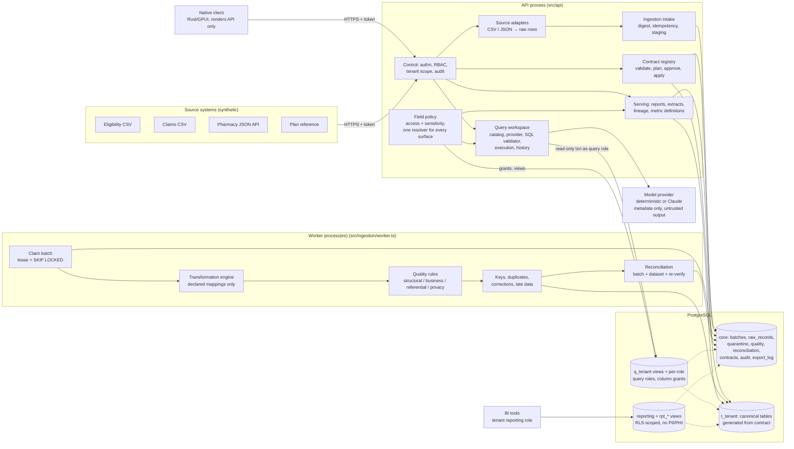

# Architecture

Clearline is a **modular monolith**: one TypeScript codebase, one PostgreSQL database, deployed as two process types from one image (API and worker), and a **native desktop client** (Rust + GPUI, [`native/`](../native/README.md)) that consumes the same API. Distributed infrastructure is deliberately absent; [scale-out.md](scale-out.md) sets out when that would change. The governed natural-language query workspace and field-level policy are described in [query-workspace.md](query-workspace.md).

> **Principle.** Data contracts define what the data means; the platform enforces the contracts; execution evidence (batches, attempts, quality results, reconciliation results, lineage, audit) records what actually happened.

## Component diagram



Plain-text version:

```
 sources ──HTTPS──▶ API [auth/RBAC → adapters → intake] ──stage──▶ core.raw_records, core.batches (queued)
                         [contract registry] ──DDL/views──▶ t_<tenant>.*
 worker ◀──claim (lease, SKIP LOCKED)── core.batches
 worker: transform → validate → keys/corrections → write canonical + quarantine + quality → reconcile → set status   (ONE transaction)
 API [reports, extracts, lineage] ◀── core + t_<tenant>          native client ──▶ API          BI login ──▶ reporting views (RLS)
 API [query workspace] ──question + permitted catalog──▶ provider ──untrusted SQL──▶ validator ──▶ q_<tenant> views
                       (clearline_query login → SET ROLE clearline_q_<tenant>_<role>, READ ONLY, timeout, row cap)
```

## Modules and dependency direction

Dependencies point downward only. Nothing below `api/` imports from `api/`, and no module imports a tenant name.

| Layer | Module | Responsibility |
|---|---|---|
| Entry | `src/main.ts`, `src/worker-main.ts`, `src/cli.ts` | Process lifecycle, signals, graceful shutdown |
| Interface | `src/api` | HTTP: authentication, authorization against `:tenant`, correlation ids, error mapping, access audit. **No business logic.** |
| Application | `src/ingestion` | Intake (idempotency, staging), worker (leases, recovery), processor (the batch transaction) |
| | `src/contracts` | Contract types, JSON Schema + semantic validation, storage compilation, version diff and migration planning, registry |
| | `src/reconciliation` | Batch checks, dataset checks, post-load re-verification |
| | `src/reporting` | Reports, extracts, lineage, and the single SQL compiler for conditions and aggregations |
| | `src/control` | Tokens and roles, tenants, audit, retention and erasure |
| | `src/policy` | Field access and sensitivity (`PolicySet`, `FieldViewer`), masking, change classification and versioning |
| | `src/query` | Permitted catalog, provider interface, SQL validator and rewrite, database query surface (views, roles, grants), execution and history |
| Domain (pure) | `src/transform`, `src/quality` | Whitelisted transforms, type coercion, exact decimal math, rule evaluation, sensitive-data detection. No I/O. |
| Infrastructure | `src/platform` | Config, database access (tenant and system scopes), migrations, structured logging, metrics |
| Client | `native/` (Rust) | GPUI desktop application and a UI-free typed API client. Renders API responses; computes nothing beyond display formatting. |

**Business logic is not duplicated.** The trusted-dataset definition, condition and aggregation compilation, and the orphan predicate live in `src/reporting/sql.ts`, used by metrics, extracts, lineage and dataset checks. The generated `rpt_trusted_*` views express the same rule in DDL for BI users, and Scenario J checks that they agree. Row-level validation lives only in `src/transform`. Trust status is set only by the processor and re-verification, and the overall verdict by the operations report. Field visibility is decided only by `src/policy` (one resolver for queries, records, lineage, extracts, exceptions, contract views and BI views). The native client renders API values and only formats them; it asks the server what a role may do instead of re-implementing it.

## The batch lifecycle

```
submitted ──structural failure──▶ rejected (untrusted, nothing staged)
    │
    ▼ digest seen before? ──yes──▶ duplicate submission recorded; original batch returned; no effect
  queued ──claim (lease)──▶ processing ──commit──▶ completed | completed_with_exceptions
    ▲                          │                       └─ trust_status: trusted | untrusted (+ reasons)
    │                          ├─ worker crash / lease expiry ──▶ queued again (attempt n+1) or failed at max_attempts
    │                          ├─ SIGTERM past grace period ──▶ aborted, rolled back, queued
    └──── replay ◀── failed ◀──┴─ processing error ──▶ failed (untrusted, no effects)
```

Two independent status axes are recorded and shown everywhere:

- **Pipeline status**: did processing run and commit?
- **Trust status**: did the batch also pass every reconciliation check and stay under its reject-rate threshold? Post-load re-verification can later revoke trust (drift detection) and restore it once the drift is repaired.

**Trusted outputs** (metrics, default extracts, `rpt_trusted_*` views) use, for each record key, the *latest version that came from a trusted batch*. A newer version from an untrusted batch is visible in "including untrusted" figures but never removes or replaces trusted data, and a later trusted delivery of the same content re-establishes it. Failing dataset-level checks qualify the trusted figures over the entities they involve, so nothing is reported as fully trusted while an invariant fails.

## Transaction boundaries and delivery semantics

- **Intake** is one transaction: register the batch, stage every row, record the submission, audit. A per-digest advisory lock means concurrent identical submissions resolve to one batch.
- **Processing** is one transaction per batch attempt. It covers transformation, every canonical write, quarantine, quality results, lineage links, reconciliation and the final status. If anything fails or the process dies, nothing is visible. The batch row stays locked `FOR UPDATE` for the whole transaction, which fences it from lease recovery while the worker is genuinely alive.
- **Delivery is at-least-once.** A batch can be processed more than once (after a crash). Effects are idempotent because an attempt either commits completely or not at all, and because exact-duplicate records are recognised by `(key, record_hash)`. No exactly-once claim is made.
- **Contract migrations** hold the tenant's exclusive advisory lock; batch processing holds it shared. No batch sees a half-migrated schema.
- **Audit events** describing a denial or a failure are written in their own transaction, so they persist when the triggering work rolls back.
- **Contract and field-policy changes** regenerate the query views, query-role column grants and BI views in the same transaction, so the database never enforces a policy older than the one stored.
- **Analytical queries** run on a separate pool and login in their own `READ ONLY` transaction under a per-(tenant, role) database role; proposals and execution records are written in separate tenant transactions before and after. Result rows are never stored.

## Tenant model

A tenant is configuration: a row in `core.tenants`, a schema `t_<tenant>`, a NOLOGIN reporting role, a query schema `q_<tenant>` with one NOLOGIN query role per data role, API tokens, contract versions and field policies. The platform administrator creates the tenant and its first admin and approver tokens; the tenant admin then issues operator and reporter tokens. Creating a tenant and publishing its contract requires no code change. Scenario B creates a third tenant at runtime, and a source scan for tenant names in `src/` finds none.

## Key design decisions

See [adr/](adr/) for the reasoning behind PostgreSQL as the queue, one-transaction batches, contract-generated storage, declarative-only transforms, the trust axis, versioned records instead of in-place updates, defence-in-depth tenant isolation, the modular monolith, governed natural-language SQL, the field policy model, and the native client.
