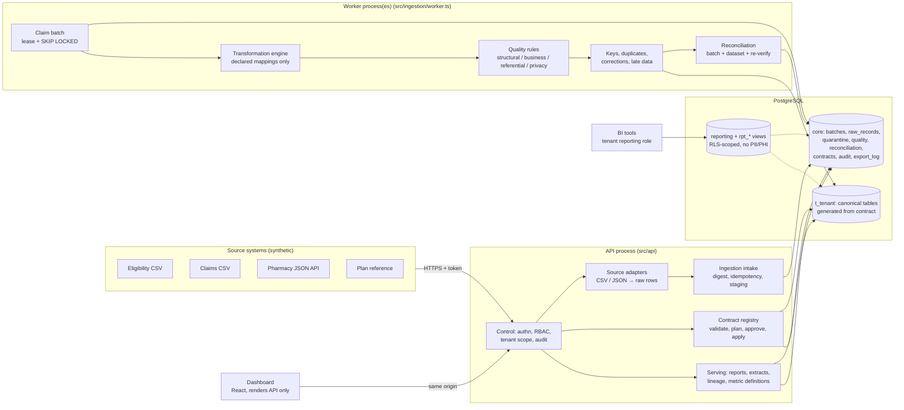

# Architecture

Clearline is a **modular monolith**: one TypeScript codebase, one PostgreSQL database, deployed as two process types from one image (API and worker). Distributed infrastructure is deliberately absent; [scale-out.md](scale-out.md) sets out when that would change.

> **Principle.** Data contracts define what the data means; the platform enforces the contracts; execution evidence (batches, attempts, quality results, reconciliation results, lineage, audit) records what actually happened.

## Component diagram



Plain-text version:

```
 sources ──HTTPS──▶ API [auth/RBAC → adapters → intake] ──stage──▶ core.raw_records, core.batches (queued)
                         [contract registry] ──DDL/views──▶ t_<tenant>.*
 worker ◀──claim (lease, SKIP LOCKED)── core.batches
 worker: transform → validate → keys/corrections → write canonical + quarantine + quality → reconcile → set status   (ONE transaction)
 API [reports, extracts, lineage] ◀── core + t_<tenant>          dashboard ──▶ API          BI login ──▶ reporting views (RLS)
```

## Modules and dependency direction

Dependencies point downward only. Nothing below `api/` imports from `api/`, and no module imports a tenant name.

| Layer | Module | Responsibility |
|---|---|---|
| Entry | `src/main.ts`, `src/worker-main.ts`, `src/cli.ts` | Process lifecycle, signals, graceful shutdown |
| Interface | `src/api` | HTTP: authentication, authorization against `:tenant`, correlation ids, error mapping, access audit. **No business logic.** |
| Application | `src/ingestion` | Intake (idempotency, staging), worker (leases, recovery), processor (the batch transaction) |
| | `src/contracts` | Contract types, JSON Schema + semantic validation, storage compilation, version diff and migration planning, registry |
| | `src/reconciliation` | Batch checks, dataset checks, post-load re-verification |
| | `src/reporting` | Reports, extracts, lineage, and the single SQL compiler for conditions and aggregations |
| | `src/control` | Tokens and roles, tenants, audit, retention and erasure |
| Domain (pure) | `src/transform`, `src/quality` | Whitelisted transforms, type coercion, exact decimal math, rule evaluation, sensitive-data detection. No I/O. |
| Infrastructure | `src/platform` | Config, database access (tenant and system scopes), migrations, structured logging, metrics |
| Client | `dashboard/` | Renders API responses. Computes nothing beyond display formatting. |

**Business logic is not duplicated.** Metric, extract and dataset-check SQL all come from `src/reporting/sql.ts`; row-level validation lives only in `src/transform`; trust status is set only by the processor and re-verification. The API, dashboard and worker call into these modules rather than reimplementing them.

## The batch lifecycle

```
submitted ──structural failure──▶ rejected (untrusted, nothing staged)
    │
    ▼ digest seen before? ──yes──▶ duplicate submission recorded; original batch returned; no effect
  queued ──claim (lease)──▶ processing ──commit──▶ completed | completed_with_exceptions
    ▲                          │                       └─ trust_status: trusted | untrusted (+ reasons)
    │                          ├─ worker crash / lease expiry ──▶ queued again (attempt n+1) or failed at max_attempts
    │                          ├─ SIGTERM past grace period ──▶ aborted, rolled back, queued
    └──── replay ◀── failed ◀──┴─ processing error ──▶ failed (untrusted, no effects)
```

Two independent status axes are recorded and shown everywhere:

- **Pipeline status**: did processing run and commit?
- **Trust status**: did the batch also pass every reconciliation check and stay under its reject-rate threshold? Only trusted batches feed trusted metrics and default extracts. Post-load re-verification can later revoke trust (drift detection).

## Transaction boundaries and delivery semantics

- **Intake** is one transaction: register the batch, stage every row, record the submission, audit. A per-digest advisory lock means concurrent identical submissions resolve to one batch.
- **Processing** is one transaction per batch attempt. It covers transformation, every canonical write, quarantine, quality results, lineage links, reconciliation and the final status. If anything fails or the process dies, nothing is visible. The batch row stays locked `FOR UPDATE` for the whole transaction, which fences it from lease recovery while the worker is genuinely alive.
- **Delivery is at-least-once.** A batch can be processed more than once (after a crash). Effects are idempotent because an attempt either commits completely or not at all, and because exact-duplicate records are recognised by `(key, record_hash)`. No exactly-once claim is made.
- **Contract migrations** hold the tenant's exclusive advisory lock; batch processing holds it shared. No batch sees a half-migrated schema.
- **Audit events** describing a denial or a failure are written in their own transaction, so they persist when the triggering work rolls back.

## Tenant model

A tenant is configuration: a row in `core.tenants`, a schema `t_<tenant>`, a NOLOGIN reporting role, API tokens and contract versions. Creating a tenant and publishing its contract requires no code change. Scenario B creates a third tenant at runtime, and a source scan for tenant names in `src/` finds none.

## Key design decisions

See [adr/](adr/) for the reasoning behind PostgreSQL as the queue, one-transaction batches, contract-generated storage, declarative-only transforms, the trust axis, versioned records instead of in-place updates, defence-in-depth tenant isolation, and the modular monolith.
